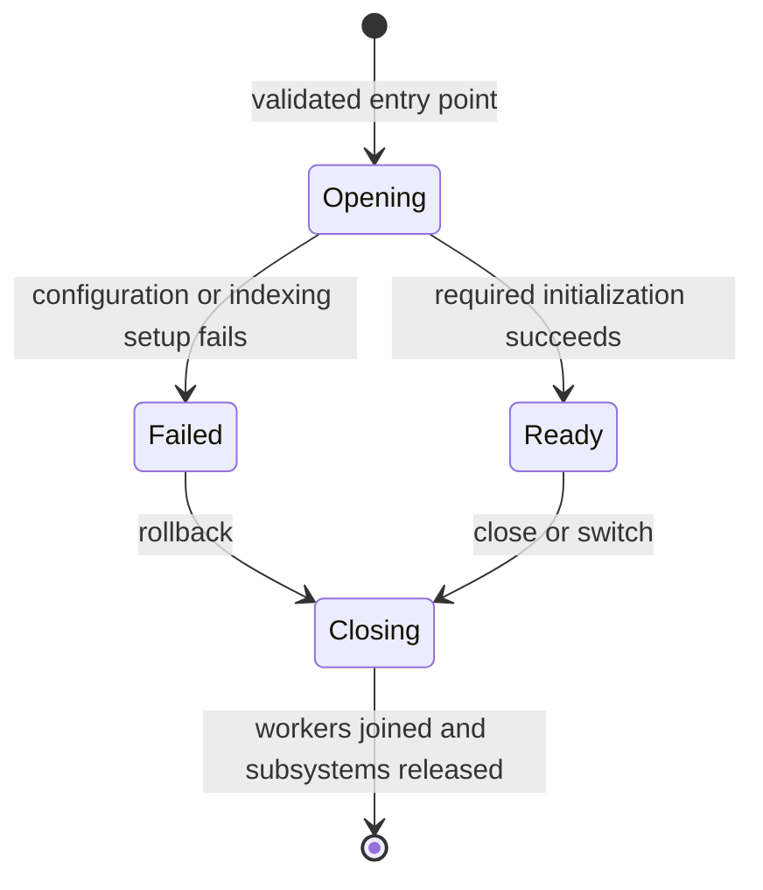

# Project manifest and Editor lifecycle

The file named `xiiProject` is the portable entry point for an XII project. Its filename and location do not change. Projects use OpenDDL format version 1. The bundled projects are stored in this format; tools require a validated manifest when opening a project.

```openddl
Project
{
  unsigned_int32 %FormatVersion { 1 }
  string %ID { "{ 12345678-1234-1234-1234-123456789ABC }" }
  unsigned_int32 %EngineVersion { 1, 0, 0 }
  string %Name { "My Project" }
  string %Description { "A portable XII project" }
  string %DataDirectories { "RuntimeConfigs/DataDirectories.ddl" }
  string %PluginSelection { "Editor/PluginSelection.ddl" }
  string %RuntimePlugins { "RuntimeConfigs/Plugins.ddl" }
  string %AssetProfiles { "Editor/AssetProfiles.ddl" }
  string %CppSettings { "Editor/CppProject.ddl" }
  string %ActiveAssetProfile { "Default" }
  string %DefaultScene { "Scenes/Main.xiiScene" }
}
```

Use the UUID syntax emitted by `xiiConversionUtils::ToString()` / `xiiProjectManifest::Write()`. The UUID above is illustrative. `Initialize()` supplies the actual engine version and a newly generated UUID.

## Ownership

| Configuration | Authority |
| --- | --- |
| Persistent project UUID, display name, description, format and minimum compatible engine version | `xiiProject` |
| Paths of configuration entry points, project default asset profile, optional default Editor scene | `xiiProject` |
| Data/asset directories, root names, write permissions and mount order | Referenced `DataDirectories` file |
| Selected Editor plugin bundles and load-copy settings | Referenced `PluginSelection` file |
| Runtime plugin modules and their deployment locations | Referenced `RuntimePlugins` file; generated from bundle selection by the Editor |
| Named asset profiles and per-type transformation/build settings | Referenced `AssetProfiles` file; runtime `.xiiProfile` files are derived outputs |
| Project C++ plugin name and build source configuration | Referenced `CppSettings` file and project CMake files |
| Window, input, tags, CVars and other runtime module configuration | Existing dedicated `RuntimeConfigs` files |
| Compiler executable, background processing preference, recent files, workspace layout, export destination and other user preferences | Existing Editor settings/preferences storage |
| Asset discovery metadata, hashes, lookup tables, compiled assets and thumbnails | Generated `AssetCache` files |

The manifest references dedicated files instead of copying their contents. This preserves runtime configuration ownership and avoids a second directory list, plugin list or asset-profile definition that could disagree with the first. Project-relative data directories remain encoded in the referenced directory configuration using the established `>project/` convention; SDK/plugin dependencies retain `>sdk/` mounts. Data-directory order, root names, document GUIDs, output paths and asset resolution rules retain their established semantics independently of the project UUID.

Background processing enablement and worker/compiler choices remain user preferences. Project-wide asset-processing policy belongs in named asset profiles. Project C++ build settings remain in their dedicated file and CMake sources. No machine path, cache, saved transform date or user preference is added to the manifest.

## Schema and compatibility

- There must be exactly one `Project` root. Fields have unique names and exact primitive types/cardinalities.
- `FormatVersion`, a nonzero `ID`, `EngineVersion` and a nonempty `Name` are required. `EngineVersion` contains three `unsigned_int32` values.
- Version 1 requires the same engine major version and an engine minor/patch version at least as recent as the recorded version. A newer format or incompatible engine fails explicitly before the active project is closed.
- Omitted configuration references use the filenames shown above. The default asset profile is `Default`; description and default scene default to empty strings.
- Configuration references and the default scene must be normalized project-relative paths. Absolute, rooted, SDK-special and parent-traversing paths are rejected. Dedicated data-directory files keep their established path semantics for compatibility.
- Unknown named fields and nested extension objects are optional. They are retained when saving, although comments and original whitespace are not retained. New mandatory semantics require a new format version.
- File reads are bounded to 1 MiB. A failed parse/validation leaves the previously loaded manifest unchanged.
- The active profile must exist after profile definitions have loaded. Corrupt existing profiles fail initialization instead of being silently replaced by defaults. An absent profiles file gets the existing default profile definitions.

`xiiProjectManifest` lives in Foundation so runtime applications can resolve configuration paths without depending on Editor or ToolsFoundation. The standard filesystem/plugin configuration entry points and C++ settings resolve their canonical configuration paths through the mounted manifest. Exported applications without a manifest retain canonical runtime paths. Runtime `-profile` remains an explicit session override.

## Persistence and identity

Writes serialize into memory, write a unique sibling staging file, close and verify its complete contents, then use same-filesystem atomic replacement. Errors retain the previous destination and return an `xiiStatus`; staging files are cleaned up where possible. Atomic visibility is guaranteed by the platform replacement operation; this is not an fsync/power-loss durability guarantee.

Opening a project retains the persisted project UUID, including after moving the project directory. Asset/document/sub-asset GUIDs, path references, preference-folder mapping and cache namespaces are not regenerated. The obsolete placeholder marker format is no longer supported, and opening a project performs no format conversion or backup creation.

Creating over an existing project is rejected. Creating from an Editor project template explicitly assigns a new project UUID while retaining the template's configuration and document GUIDs. `SaveManifest()` rejects attempts to change the identity of an open project. Display-name edits do not rename the project directory or generated C++ identifiers.

## Lifecycle contract



1. Preflight validates the candidate manifest before destroying the active project. The Editor resolves plugin configuration and loads required document/asset types.
2. ToolsFoundation creates the project in `Opening`. `IsProjectOpen()` is false. `ProjectOpening` is a synchronous initialization event; required subsystem listeners report failures through its borrowed status. They must not retain that status pointer.
3. The Editor loads project settings, validates/applies required data directories, registers asset types, loads profiles, starts the curator scan, initializes the rendering process and joins the initial scan. Core collections and the Editor viewport / selected scene pipeline transform after readiness and before restoring user documents. These rendering prerequisites live at the Editor boundary, outside generic ToolsFoundation project policy. Initialization does not pump a nested Qt event loop while waiting for the curator task.
4. After required initialization succeeds, ToolsFoundation changes to `Ready` and broadcasts `ProjectOpened`. Observers can discover assets and submit immediate transformations at this point. Startup restoration, explicit/queued opens, project creation and document-triggered discovery use this contract.
5. A required initialization failure emits `ProjectOpenFailed`, then runs the closing/closed cleanup path. No public `ProjectOpened` is emitted for that attempt. The user can fix the configuration and retry in the same Editor when its loaded module selection is compatible.
6. Saving emits `ProjectSaveState` and leaves readiness, closing state and generation unchanged.
7. Closing first invalidates the session generation and stops admission. Processor workers are canceled and joined while the project, profiles and documents still exist. Curator scan/update tasks are joined before file-model, caches, profiles and data-directory teardown. `ProjectClosed` has a null project pointer.

`xiiAssetCurator::IsReady()` describes completed initial indexing. It is distinct from project object existence. Queueing transformations requires both a ready project and a ready curator. Requests made too early return an explanatory failure; callers must display it and retry after `ProjectOpened`. Core asset transformation failures remain diagnostics in the indexed project so their inputs can be repaired and transformations retried.

Rendering readiness is independently exposed by `xiiEditorEngineProcessConnection::IsEngineSetup()`. A rendering-process failure produces degraded feedback and permits asset operations supported by their own processors. Engine setup acknowledges required data-directory failures explicitly; connection/setup waits are bounded. Repairing/restarting the rendering process does not redefine project identity.

Background processing and explicit full transformations start from readiness without one/two-second startup timers. Declining a full transformation does not falsely record a successful transform date. Completed batches retain failure/import/cancellation counts and asset diagnostics for recovery. The cancellation flag is reset before starting a new processor session.

## Asynchronous work and switching

The persistent UUID identifies the project on disk. A monotonic process-local generation identifies each open session, including reopening the same project. Close invalidates the generation before worker shutdown. Queued open/close/document requests, save-triggered transforms and completion/table-publication callbacks check the captured generation. Stale callbacks cannot mutate a later project merely because the same GUID is present there.

Curator scans and worker IPC processes are owned and drained by their project session. Failed transforms retain their curator errors; canceled work remains counted and can be queued again. Import deferrals are cleared during curator teardown. Switching between projects with identical Editor module configuration can reuse the Editor. Changing its selected Editor modules, or switching project-local C++ modules, retains the existing new-process handoff because loaded Editor DLLs cannot safely be replaced in place.

## Validation

- Foundation `ProjectManifest/Format`: round trip, stable relocation identity, schema/version/type/cardinality rejection, path validation, engine compatibility, preserved optional extensions, transactional file-load rejection and failed replacement.
- Foundation `ProjectManifest/BundledProjects`: validated bundled manifests with stable persistent identities across repeated loads.
- ToolsFoundation `ProjectLifecycle/Tools`: create/open/save/close/reopen, preflight rejection preserving the active project, switching, failed required initialization, cleanup/retry, immutable project identity and generation invalidation.
- Editor `EditorProjectLifecycle/AssetsWithoutRestart`: real surface asset transformation immediately after opening, queued transformation and stale close/document callbacks across switching, indexed reopening with preserved GUIDs, successful background transformation without restarting the Editor, configuration failure/recovery, relocated configuration files and document-triggered discovery.

Use fresh isolated test output directories. Additional integration, processor/profile, background-transformation and runtime validation results are recorded in the pull request. Platform implementations exist for Windows and POSIX; do not infer non-Windows or Shipping validation from the Windows Debug workflow.

Public lifecycle events and initialization status signatures have changed. Rebuild Editor/tool plugins against the updated headers; retain module-specific runtime configuration ownership. Hand-edited configuration references take effect on the next project open.
